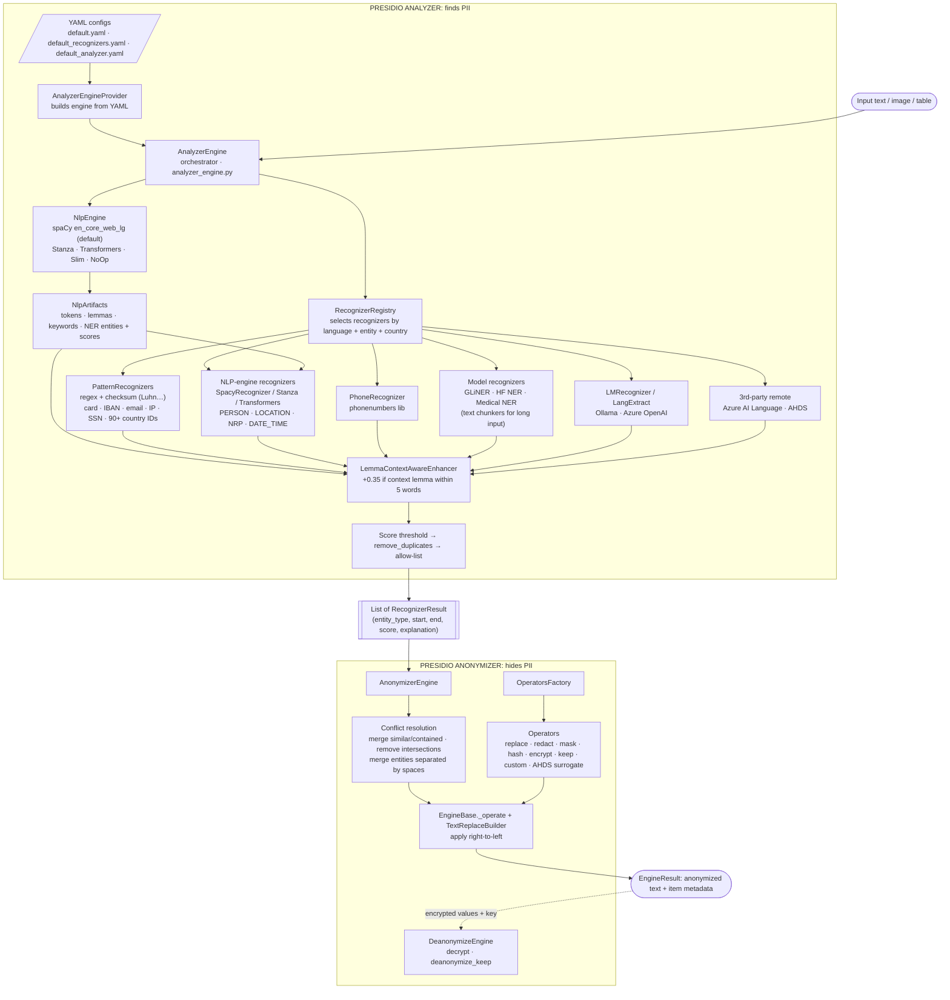
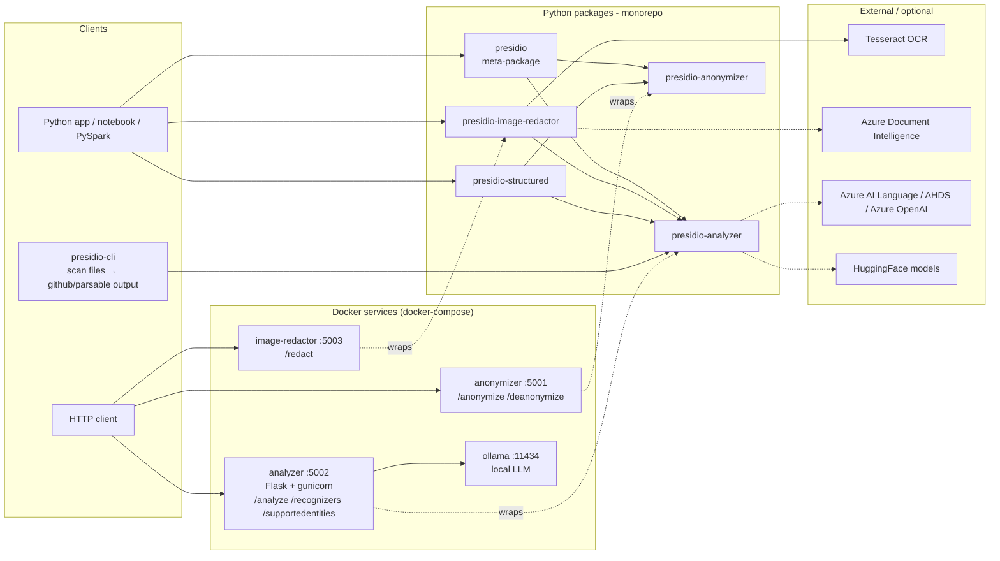
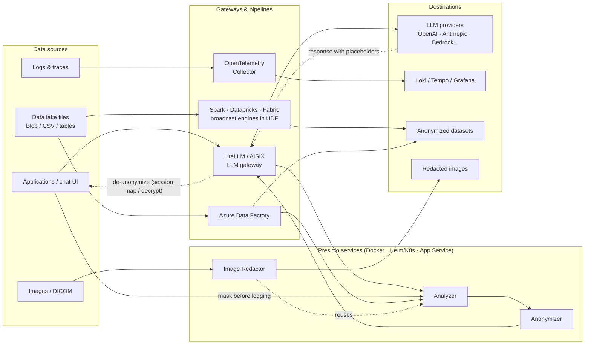

# Presidio — End-to-End Architecture

> Source studied: <https://github.com/data-privacy-stack/presidio> (`main` branch). The full repository is downloaded locally at [presidio-main/](presidio-main/). All 917 files were checked against GitHub's file list.
> Presidio was originally a Microsoft project and is now a community-governed project under the **Data Privacy Stack** GitHub org (MIT license). Docker images moved from `mcr.microsoft.com/presidio-*` to `ghcr.io/data-privacy-stack/presidio-*`.

---

## Table of contents

1. [What problem Presidio solves](#1-what-problem-presidio-solves)
2. [The big picture: two-step design](#2-the-big-picture-two-step-design)
3. [Repository layout](#3-repository-layout)
4. [Presidio Analyzer: finding PII](#4-presidio-analyzer--finding-pii)
5. [Presidio Anonymizer: hiding PII](#5-presidio-anonymizer--hiding-pii)
6. [Presidio Image Redactor: PII in images and DICOM](#6-presidio-image-redactor--pii-in-images-and-dicom)
7. [Presidio Structured: PII in tables and JSON](#7-presidio-structured--pii-in-tables-and-json)
8. [Presidio CLI and the `presidio` meta-package](#8-presidio-cli-and-the-presidio-meta-package)
9. [Deployment: REST services, Docker, docker-compose](#9-deployment--rest-services-docker-docker-compose)
10. [Engineering tooling, CI/CD and contribution rules](#10-engineering-tooling-cicd-and-contribution-rules)
11. [Technology summary: what and why](#11-technology-summary--what-was-used-and-why)
12. [A request, end to end](#12-a-request-end-to-end-worked-example)
13. [Architecture diagrams](#13-architecture-diagrams)
14. [Ecosystem: deployment and integration samples](#14-ecosystem--deployment-and-integration-samples-docssamples)

---

## 1. What problem Presidio solves

Organisations hold text, images and tables that contain **PII** (Personally Identifiable Information): names, phone numbers, credit cards, SSNs, IBANs, medical IDs and so on. Presidio is an **SDK and a set of services** that:

1. **Identify** where PII sits in the data (entity type, position, confidence score).
2. **De-identify** it by replacing, masking, hashing, encrypting or redacting it. Encryption can be reversed later.

Its design goals, from the README:

- **Democratise de-identification.** Easy to use, and transparent about *why* something was flagged.
- **Extensibility and customisation.** Add your own recognizers, NLP models or operators.
- **Run anywhere.** A Python library, PySpark, Docker, Kubernetes, or a REST API.

> ⚠️ Detection is automated and probabilistic, so Presidio **cannot guarantee** it finds all PII. It is meant to be one layer of protection, not the only one.

---

## 2. The big picture: two-step design

The most important architectural decision in Presidio is that **detection and transformation are separate**:

```
text ──► ANALYZER ──► List[RecognizerResult] ──► ANONYMIZER ──► anonymized text
          (where is PII?)   (type, start, end, score)   (what do we do with it?)
```

**Why split them?**

| Reason | Explanation |
|---|---|
| **Separation of concerns** | Detection is heavy work (NLP models, regex, ML) and needs a lot of RAM. Replacing text is cheap string manipulation. |
| **Independent scaling** | The Analyzer can run on big machines while the Anonymizer runs on small ones, as separate Docker containers. |
| **Human in the loop** | A person can review or edit the analyzer results before anonymization ("semi-automated flows"). |
| **Reuse** | Image Redactor and Structured reuse the same Analyzer. Anonymizer results can come from *any* detector, not just Presidio's. |
| **Minimal dependencies** | `presidio-anonymizer` depends only on `cryptography`. It does not pull in spaCy. |

The contract between the two steps is a very simple data object: `RecognizerResult(entity_type, start, end, score)`.

---

## 3. Repository layout

The repository is a **monorepo**: several independently versioned Python packages live in one Git repo.

```
presidio/
├── presidio-analyzer/          # PII detection (the core; heaviest package)
│   ├── presidio_analyzer/      # library code
│   ├── app.py                  # Flask REST server
│   ├── Dockerfile(.stanza/.transformers/.windows/.dev)
│   ├── install_nlp_models.py   # downloads spaCy/Stanza/HF models at build time
│   └── tests/
├── presidio-anonymizer/        # PII transformation (replace/mask/hash/encrypt...)
├── presidio-image-redactor/    # OCR + analyzer + draw boxes; DICOM support
├── presidio-structured/        # pandas / JSON de-identification
├── presidio-cli/               # "linter-like" CLI to scan files for PII
├── presidio/                   # meta-package: installs analyzer + anonymizer
├── e2e-tests/                  # end-to-end tests against running containers
├── docs/                       # mkdocs site + 190 sample notebooks/deployments
├── docker-compose.yml          # runs all services + Ollama (local LLM)
├── .github/workflows/          # CI (lint, test, build, release)
└── pyproject.toml, uv.lock     # per-package Python packaging (uv)
```

**Why a monorepo with separate packages?** Users install only what they need. For example, `pip install presidio-anonymizer` pulls no ML dependencies. Keeping everything in one repo still lets the team test the packages together (`e2e-tests`) and release them in step.

---

## 4. Presidio Analyzer: finding PII

Package: `presidio-analyzer/presidio_analyzer/`. This is the heart of the system.

### 4.1 Components at a glance

| Component | File(s) | Role |
|---|---|---|
| `AnalyzerEngine` | `analyzer_engine.py` | Orchestrator; runs the whole detection pipeline |
| `AnalyzerEngineProvider` | `analyzer_engine_provider.py` | Builds an `AnalyzerEngine` from YAML config files |
| `NlpEngine` (+ provider) | `nlp_engine/` | Runs the NLP pipeline once per text: tokens, lemmas, NER |
| `NlpArtifacts` | `nlp_engine/nlp_artifacts.py` | Holds the NLP output, shared by all recognizers |
| `RecognizerRegistry` (+ provider) | `recognizer_registry/` | Holds all recognizers and picks which ones to run |
| `EntityRecognizer` hierarchy | `entity_recognizer.py`, `local_recognizer.py`, `remote_recognizer.py`, `pattern_recognizer.py`, `lm_recognizer.py` | Detectors |
| Predefined recognizers | `predefined_recognizers/` | 100+ ready-made detectors (generic, per-country, NER, third-party) |
| `ContextAwareEnhancer` | `context_aware_enhancers/` | Raises scores when context words appear near a match |
| `RecognizerResult`, `AnalysisExplanation` | `recognizer_result.py`, `analysis_explanation.py` | Output and explainability |
| `BatchAnalyzerEngine` | `batch_analyzer_engine.py` | Runs the analyzer over lists, iterators and dicts |
| Chunkers | `chunkers/` | Split long text into offset-tracked chunks for length-limited models |
| `AppTracer` | `app_tracer.py` | Logs the decision process for auditing |
| Input validation | `input_validation/` | Pydantic schemas that validate YAML configs |
| LLM utilities | `llm_utils/` | Prompt, example, config and auth helpers for LLM-based recognizers |

### 4.2 `AnalyzerEngine.analyze()`: the pipeline

This is the actual order of operations in `analyzer_engine.py`:

```
1. registry.get_recognizers(language, entities, ad_hoc_recognizers)
       → choose only the recognizers that support this language and these entities
2. nlp_engine.process_text(text, language)   → NlpArtifacts (run ONCE, shared)
3. for each recognizer:
       lazy-load it if needed (recognizer.load())
       results += recognizer.analyze(text, entities, nlp_artifacts)
       tag each result with recognizer id and name
4. _enhance_using_context()
       a) each recognizer's own enhance_using_context() (custom logic)
       b) the global LemmaContextAwareEnhancer (context-word boosting)
5. __remove_low_scores()        → score-threshold filtering
6. EntityRecognizer.remove_duplicates()  → drop duplicate and contained spans
7. _remove_allow_list()         → drop values the user said are OK (exact or regex)
8. strip analysis_explanation unless return_decision_process=True
→ List[RecognizerResult]
```

**Why this order?**

- **NLP runs once.** Running spaCy is the most expensive step. It happens once, and every recognizer reuses the result through `NlpArtifacts` instead of running its own model.
- **Recognizers are loaded lazily** (`is_loaded`), so heavy models only load if a request actually needs them.
- **Context enhancement comes before threshold filtering.** A weak regex match (say 0.3) can be boosted above the threshold when words like "phone" or "ssn" appear nearby.
- **Thresholds are applied before deduplication.** The code comments say this is so that per-recognizer thresholds are not lost when duplicate spans collapse.
- **Threshold resolution order:** the explicit `score_threshold` argument, then the recognizer's per-entity threshold, then the recognizer's `default` threshold, then the engine's `default_score_threshold`.

### 4.3 NLP Engine layer

`NlpEngine` is an **abstraction** (strategy pattern) over different NLP libraries. `NlpEngineProvider` reads a YAML file and builds the right one (factory pattern).

| Engine | `nlp_engine_name` | What it is | Why you would use it |
|---|---|---|---|
| `SpacyNlpEngine` | `spacy` | spaCy pipeline (default model `en_core_web_lg`) | Default. Fast, CPU-friendly, gives tokens, lemmas and NER in one pass |
| `StanzaNlpEngine` | `stanza` | Stanford Stanza | Better accuracy for some languages |
| `TransformersNlpEngine` | `transformers` | HuggingFace model for NER plus a small spaCy model for tokens and lemmas | State-of-the-art NER accuracy (BERT-style models); needs more compute |
| `SlimSpacyNlpEngine` | `slim` | Lightweight spaCy (tokenizer only) | Low footprint when you mostly rely on regex recognizers |
| `NoOpNlpEngine` | `no_op` | Does nothing | Pure regex or LLM setups; no models to download |

`device_detector.py` picks CPU or GPU automatically for model-based engines.

**Default config** (`conf/default.yaml`):

```yaml
nlp_engine_name: spacy
models: [{lang_code: en, model_name: en_core_web_lg}]
ner_model_configuration:
  model_to_presidio_entity_mapping:   # spaCy label -> Presidio entity
    PER/PERSON: PERSON,  NORP: NRP,  FAC/LOC/GPE: LOCATION,
    ORG: ORGANIZATION,   DATE/TIME: DATE_TIME
  low_confidence_score_multiplier: 0.4
  labels_to_ignore: [ORGANIZATION, CARDINAL, MONEY, PERCENT, ...]  # ORG = many false positives
```

**Why the mapping?** Each NER model has its own label set (`GPE`, `PER`, `B-PER`...). The mapping turns them into Presidio's single vocabulary (`PERSON`, `LOCATION`...), so that everything downstream (the anonymizer operators, for example) is model-independent.

> Note: the sample diagram mentions `en_core_web_sm`. The actual default in the repo is **`en_core_web_lg`**, which is larger and more accurate. `sm` is used as the tokenizer and lemmatizer in `conf/transformers.yaml`, where a HuggingFace model does the NER (see §9).

### 4.4 `NlpArtifacts`

A plain data holder that every recognizer receives:

- `tokens` (a spaCy `Doc`), `tokens_indices`, `lemmas`
- `entities` (NER spans) plus `scores` (defaults to 0.85 if the model gives no score)
- `keywords`: lemmas lowercased, with stop-words, punctuation, `-PRON-` and `be` removed. The context enhancer uses these.

**Why?** It decouples recognizers from the NLP library. A recognizer does not care whether spaCy or Stanza produced the tokens.

### 4.5 Recognizers: the detection plug-ins

The class hierarchy:

```
EntityRecognizer (abstract)           # analyze(), load(), enhance_using_context(), remove_duplicates()
├── LocalRecognizer                   # runs in the same process
│   ├── PatternRecognizer             # regex + deny-list + validate/invalidate (checksums)
│   │   ├── CreditCardRecognizer, EmailRecognizer, IbanRecognizer, IpRecognizer,
│   │   │   UrlRecognizer, CryptoRecognizer, DateRecognizer, MacRecognizer, UuidRecognizer
│   │   └── 84 country-specific ones in 18 country folders (US SSN, UK NHS, IN Aadhaar, DE Steuer-ID, ...)
│   ├── SpacyRecognizer / StanzaRecognizer / TransformersRecognizer
│   │         # do NOT run a model; they read NER output from NlpArtifacts
│   ├── PhoneRecognizer               # uses Google's libphonenumber port (phonenumbers)
│   ├── GLiNERRecognizer              # zero-shot NER (uses a text chunker)
│   └── HuggingFaceNerRecognizer      # any HF token-classification model (uses a text chunker)
│       └── MedicalNERRecognizer      # clinical NER model
└── RemoteRecognizer                  # calls another process or service
    ├── AzureAILanguageRecognizer     # Azure AI Language PII API
    ├── AzureHealthDeidRecognizer     # Azure Health De-identification (AHDS)
    └── LMRecognizer                  # LLM-based detection (abstract _call_llm)
        └── LangExtractRecognizer     # Google LangExtract
            ├── BasicLangExtractRecognizer        (e.g. local Ollama)
            └── AzureOpenAILangExtractRecognizer
```

In total there are about 105 recognizer classes under `predefined_recognizers/`.

**How `PatternRecognizer` works** (`pattern_recognizer.py`):

1. Compile each `Pattern(name, regex, score)`. Flags default to `DOTALL | MULTILINE | IGNORECASE`.
2. `finditer` with a **timeout** (`REGEX_TIMEOUT_SECONDS`, default 60 s) through the third-party `regex` library.
3. For each match, call `validate_result()`. For example, `CreditCardRecognizer` runs the **Luhn checksum**:
   - `True` sets the score to 1.0 (certain)
   - `False` sets it to 0.0, and the match is dropped
4. `invalidate_result()` lets a recognizer reject known false-positive shapes.
5. Attach an `AnalysisExplanation`: which pattern matched, the original score, and the validation outcome.

**Why regex plus checksums *and* NER?** Structured PII (cards, IBANs, SSNs) has fixed formats and check digits, so regex is fast, precise and explainable. Unstructured PII (names, places) has no format and needs ML. Presidio mixes both, so each kind of PII gets the right tool.

**Why LLM recognizers?** They catch PII that regex and classic NER miss, such as complex PHI in medical text. They are *optional*, and `docker-compose.yml` ships an **Ollama** container so this can run locally without sending data to the cloud.

**Why chunkers?** Transformer models have maximum input lengths (for example 512 tokens). `BaseTextChunker` splits text into `TextChunk(text, start, end)`, keeping the original offsets so results can be mapped back to the full text and de-duplicated across overlapping chunks. Two strategies ship: `CharacterBasedTextChunker` and `TokenizerBasedTextChunker`. They are used by `GLiNERRecognizer`, `HuggingFaceNerRecognizer` and `MedicalNERRecognizer`.

**How pattern scores are chosen.** The contributor rules in `.github/instructions/recognizers.instructions.md` set the base score by how much the regex *alone* narrows things down:

| Base score | Pattern kind | Example |
|---|---|---|
| 0.05–0.1 | bare digit/alphanumeric run, no structure ("very weak") | `UsPassportRecognizer`: nine bare digits = 0.05 |
| 0.1–0.3 | some structure: delimiters, prefix, length ("weak") | |
| 0.3–0.5 | distinctive format, no validation ("medium") | |
| 0.5+ | distinctive format ("strong") | |

Weak scores are intentional. **Context words** and **checksums** raise them, and **`score_thresholds`** filter out what remains low. For example, `validate_result` returning `True` sets the score to 1.0, and `False` or `invalidate_result` returning `True` drops the result.

### 4.6 Recognizer Registry

`RecognizerRegistry` holds a list of recognizers and answers one question: *"for language X and entities Y, which recognizers should run?"*

- Built by `RecognizerRegistryProvider` from `conf/default_recognizers.yaml`.
- Each YAML entry sets `name`, `type: predefined|custom`, `supported_languages` (with **per-language context words**), `enabled`, `country_code`, and `score_thresholds`.
- `supported_countries` can restrict loading to specific countries, such as only `us` and `uk`.
- **What loads by default:** the shipped YAML has **95 entries, but only 25 are `enabled`**: generic ones (credit card, email, IBAN, IP, URL, phone, crypto, date, MAC, UUID, medical license), US IDs, UK NHS, and a few ES/IT/PL IDs. The other 70, mostly country-specific, ship `enabled: false` and are opt-in. Because the default `supported_languages` is only `en`, the Spanish, Italian and Polish recognizers are also filtered out unless you add those languages. The spaCy `SpacyRecognizer` is added separately by `add_nlp_recognizer()` to match the NLP engine.
- `add_recognizer()`, `remove_recognizer()`, `add_recognizers_from_yaml()` and `add_pattern_recognizer_from_dict()` add recognizers at runtime.
- **Ad-hoc recognizers** can be passed with a single `analyze()` call or REST request without changing the registry.
- `validate_nlp_engine_compatibility()` makes sure, for example, that a `SpacyRecognizer` is not paired with a Stanza engine.

**Why a registry plus YAML?** It turns Presidio into a *no-code configurable* system. Operators can enable or disable recognizers, add country filters, or add custom regex without writing Python. This is the main extensibility point.

### 4.7 Context-aware enhancement

`LemmaContextAwareEnhancer`, with its defaults:

| Parameter | Default | Meaning |
|---|---|---|
| `context_prefix_count` | 5 | Look at 5 words **before** the match |
| `context_suffix_count` | 0 | Look at 0 words after the match |
| `context_similarity_factor` | 0.35 | Add +0.35 to the score if a context word is found |
| `min_score_with_context_similarity` | 0.4 | The boosted score is at least 0.4 |
| `context_matching_mode` | `substring` | Or `whole_word`, which avoids "lic" matching "dup**lic**ate" |

It compares the **lemmas** of the surrounding words (from `NlpArtifacts`) with the recognizer's `context` list, and with extra `context` passed in the request. A result is boosted only once, and the boost is recorded in `AnalysisExplanation`.

**Why?** Many PII patterns are ambiguous. `123-45-6789` could be an SSN or a part number. A low base score plus a context boost cuts down false positives without missing real PII. Lemmas make "phones" and "phone" count as the same word.

### 4.8 Post-processing

- **`remove_duplicates`**: groups results by entity type, drops zero-score results, and drops results fully contained in another result of the same type that has an equal or higher score.
- **Allow-list**: values the user explicitly marks as *not* PII (for example the company's own support phone number). Matching is `exact` or `regex`, and regex uses a timeout.
- **Explainability**: `return_decision_process=True` returns each result's `AnalysisExplanation` (recognizer, pattern, original score, context boost). `AppTracer` can log the whole decision process per `correlation_id`.

---

## 5. Presidio Anonymizer: hiding PII

Package: `presidio-anonymizer/presidio_anonymizer/`. Its only runtime dependency is `cryptography`.

### 5.1 Components

| Component | Role |
|---|---|
| `AnonymizerEngine` | Takes text, analyzer results and an operator config; returns an `EngineResult` |
| `DeanonymizeEngine` | Reverses reversible operators (for example `decrypt`) |
| `BatchAnonymizerEngine` / `BatchDeanonymizeEngine` | Process lists and dicts (pairs with `BatchAnalyzerEngine`) |
| `EngineBase._operate()` | Shared loop that applies operators to spans |
| `TextReplaceBuilder` | Safely rewrites text as spans change length |
| `OperatorsFactory` | Registry of available operators (factory pattern) |
| `Operator` (abstract) | `operate(text, params)`, `validate(params)`, `operator_name()`, `operator_type()` |
| `OperatorConfig` | `{operator_name, params}` chosen per entity type (or `DEFAULT`) |
| `ConflictResolutionStrategy` | How overlapping spans are handled |
| `EngineResult` / `OperatorResult` | Output text plus metadata for each replaced item |

### 5.2 Operators

| Anonymize operator | What it does | Typical use |
|---|---|---|
| `replace` (**default**) | Replace with `<ENTITY_TYPE>` or a given `new_value` | Readable, analytics-friendly output |
| `redact` | Remove the text | Maximum privacy |
| `mask` | Replace N characters with `*` (from start or end) | `****-****-****-1234` |
| `hash` | SHA-256 / SHA-512 with a salt (random per entity unless you supply one) | Consistent pseudonyms for joins or analytics |
| `encrypt` | **AES-CBC**, PKCS7 padding, random IV, 128/192/256-bit key | Reversible pseudonymisation |
| `keep` | Leave as is (but report it) | Audit-only flows |
| `custom` | Any Python lambda | Fake-data generation (for example Faker) |
| `surrogate_ahds` (optional) | Azure Health De-identification realistic surrogates | Healthcare |

| Deanonymize operator | |
|---|---|
| `decrypt` | Reverses `encrypt` with the same key |
| `deanonymize_keep` | No-op counterpart of `keep` |

**Why operators as plug-ins?** Every business wants a different transformation. `add_anonymizer()` / `remove_anonymizer()` let you register your own without changing the engine (open/closed principle).

### 5.3 `anonymize()` flow

```
1. copy and sort analyzer results by (start, end)
2. resolve conflicts:
     - merge overlapping results of the SAME entity type (union of span, max score)
     - drop results contained in / conflicting with higher-scoring ones
     - if REMOVE_INTERSECTIONS: trim partially overlapping spans (higher score wins)
3. optionally merge adjacent same-type entities separated only by whitespace
   ("James" + " " + "Bond" -> one PERSON)
4. make sure a DEFAULT operator exists (replace)
5. EngineBase._operate():
     for each entity, processed from END to START:
         pick operator for entity_type (or DEFAULT) → operate → TextReplaceBuilder.replace
     normalise item indexes to the final text
→ EngineResult(text, items=[OperatorResult(start,end,entity_type,text,operator)])
```

**Why process from end to start?** Replacing `"John"` with `"<PERSON>"` changes the length of the text. Working right to left means the start and end offsets of the spans still to be processed stay valid. Indexes are normalised once at the end.

---

## 6. Presidio Image Redactor: PII in images and DICOM

Package: `presidio-image-redactor/`. It depends on `presidio-analyzer`, Pillow, OpenCV, pytesseract, pydicom, python-gdcm, and `azure-ai-formrecognizer`.

```
image → ImagePreprocessor → OCR → text + word bounding boxes
      → AnalyzerEngine.analyze(text)  (the same analyzer as above!)
      → map character spans back to OCR word boxes → ImageRecognizerResult(bbox)
      → draw filled rectangles → redacted image
```

| Component | Role and why |
|---|---|
| `ImagePreprocessor` subclasses (`BilateralFilter`, `SegmentedAdaptiveThreshold`, `ImageRescaling`, `ContrastSegmentedImageEnhancer`) | Clean up the image (denoise, binarise, rescale, improve contrast) because **OCR quality drives recall**. Uses OpenCV. |
| `OCR` (abstract) → `TesseractOCR`, `DocumentIntelligenceOCR` | Pluggable OCR: free and local Tesseract, or the more accurate Azure Document Intelligence |
| `ImageAnalyzerEngine` | Runs OCR, applies an OCR confidence threshold, calls `AnalyzerEngine`, maps results to boxes, rescales boxes if the image was resized |
| `ImageRedactorEngine` | Copies the image and paints the PII boxes with `fill` colour |
| `DicomImageRedactorEngine` | Medical images: reads DICOM with `pydicom`/`gdcm`, builds a **PHI list from DICOM metadata** (patient name variants and so on) to use as extra deny-list context, handles greyscale and compressed pixel data, and redacts whole files or directories |
| `ImagePiiVerifyEngine`, `DicomImagePiiVerifyEngine` | Draw the detected boxes (matplotlib) so a human can **verify** the redaction |
| `BboxProcessor` (`bbox.py`) | Box utilities, matching boxes to ground truth for evaluation |

**Why reuse the text Analyzer?** There is one detection brain for every modality. Every recognizer, config and improvement automatically applies to images too.

---

## 7. Presidio Structured: PII in tables and JSON

Package: `presidio-structured/`. It depends on the analyzer, the anonymizer, and pandas.

In a table, the **column** is usually the unit of PII (the whole `email` column), not an individual cell. So:

```
DataFrame/JSON ──► AnalysisBuilder ──► StructuredAnalysis {column/key → entity_type}
                    (samples values, runs BatchAnalyzerEngine,
                     picks an entity per column: most_common | highest_confidence | mixed)
               ──► StructuredEngine.anonymize(data, analysis, operators)
                    └─► DataProcessor (PandasDataProcessor | JsonDataProcessor)
                          applies anonymizer Operators to every value of that column/key
```

**Why?** Analysing every cell is slow and noisy. Deciding once per column and then applying one operator is faster and more consistent. `JsonDataProcessor` supports arbitrarily nested dicts and lists. `TabularAnalysisBuilder` exists as a base for future PySpark support.

---

## 8. Presidio CLI and the `presidio` meta-package

- **`presidio-cli`**: a *linter-like* command-line tool (built with `click`, `pathspec` and `pyyaml`). It scans files or folders with the Analyzer, respects ignore rules and a `.presidiocli` config file, and prints findings in `standard`, `colored`, `parsable` or **`github`** (GitHub annotations) format. **Why:** it lets you catch PII being committed, for example in CI.
- **`presidio`** (meta-package): only depends on `presidio-analyzer` and `presidio-anonymizer`. **Why:** a single `pip install presidio` for the common case.

---

## 9. Deployment: REST services, Docker, docker-compose

Each main package also ships as a **microservice**: a small Flask app (`app.py`) run by **gunicorn** (or **waitress** on Windows) through `entrypoint.sh`.

| Service | Endpoints | Port in `docker-compose.yml` |
|---|---|---|
| presidio-analyzer | `POST /analyze`, `GET /recognizers`, `GET /supportedentities`, `GET /health` | host **5002** → container 5001 |
| presidio-anonymizer | `POST /anonymize`, `POST /deanonymize`, `GET /anonymizers`, `GET /deanonymizers`, `GET /health` | **5001** |
| presidio-image-redactor | `POST /redact`, `GET /health` | **5003** |
| ollama | local LLM runtime for LLM recognizers | **127.0.0.1:11434** |

**Analyzer Dockerfile highlights (and the reasons for them):**

- `python:3.12-slim` pinned by **sha256 digest**, for reproducible and secure builds.
- `uv sync --locked`: installs exactly the dependency graph in `uv.lock`.
- `install_nlp_models.py` **downloads the NLP models at build time**, so containers start fast and work offline.
- Config is injected through env vars `NLP_CONF_FILE`, `ANALYZER_CONF_FILE` and `RECOGNIZER_REGISTRY_CONF_FILE`. You can build different images (spaCy, Stanza, Transformers) from the same code.
- Runs as a **non-root user** (uid 1001), with a `HEALTHCHECK` on `/health`, for security and orchestration (Kubernetes, compose).
- Variants: `Dockerfile.stanza`, `Dockerfile.transformers`, `Dockerfile.windows`, `Dockerfile.dev`.

At startup the Analyzer server uses `AnalyzerEngineProvider(...).create_engine()`, which loads the three YAMLs, and creates a `BatchAnalyzerEngine` next to it.

**REST request details:**

- **`POST /analyze`** takes `text` (a string, **or a list of strings for batch**), `language`, and optionally `entities`, `score_threshold`, `correlation_id`, `return_decision_process`, `ad_hoc_recognizers` (JSON pattern recognizers), `context`, `allow_list`, `allow_list_match` and `regex_flags`. Every request, even a single string, goes through `BatchAnalyzerEngine.analyze_iterator()`. The env vars `BATCH_SIZE` (default 500) and `N_PROCESS` (default 1) control spaCy `nlp.pipe` batching and multiprocessing.
- **`POST /redact`** (image redactor) accepts either a multipart file upload (uses `score_threshold=0.4`) or JSON with a base64 `image` plus optional `analyzer_entities`. It returns the redacted image bytes. Invalid input returns HTTP 422.
- **Transformers image variant:** `Dockerfile.transformers` uses `conf/transformers.yaml`. That config runs the clinical de-identification model **`StanfordAIMI/stanford-deidentifier-base`** for NER, with `en_core_web_sm` for tokens and lemmas, `stride: 16` for long texts, and a mapping that turns medical labels (`PATIENT`, `STAFF`, `HOSP`, `AGE`, `ID`...) into Presidio entities. This is where `en_core_web_sm` from the sample diagram actually comes from.
- Other NLP configs shipped in `conf/`: `spacy_multilingual.yaml`, `stanza.yaml`, `stanza_multilingual.yaml`, `slim.yaml`, `slim_nlp.yaml`, `no_op.yaml`, `langextract_config_basic.yaml` (Ollama), `langextract_config_azureopenai.yaml`, and `default_analyzer_full.yaml`.

**Why the Anonymizer and Analyzer are separate containers:** the analyzer image holds large ML models and needs a lot of memory. The anonymizer is tiny. They scale independently, and the anonymizer can hold encryption keys in a more restricted network zone.

---

## 10. Engineering tooling, CI/CD and contribution rules

### 10.1 Tools

| Tool | Where | Why |
|---|---|---|
| **uv** + `uv.lock` | every package | Fast, reproducible dependency resolution and installs. CI fails if `uv.lock` drifts from `pyproject.toml`. |
| **Pydantic v2** | `input_validation/` | Validates YAML configs early, with clear error messages |
| **pytest** (+ pytest-cov, pytest-mock) | `*/tests`, `e2e-tests/` | Unit tests per package; E2E tests call the running Docker services |
| **ruff** + `.pre-commit-config.yaml` | repo root | Linting and formatting |
| **Dependabot** | `.github/dependabot.yml` | Keeps dependencies patched |
| **MkDocs** (`mkdocs.yml`, `scripts/zensical_build.py`) | `docs/` | Documentation site with 190 sample files (Spark, Azure, Kubernetes, notebooks...) |
| **devcontainers** | `.devcontainer/` | One-click dev environment per package |
| **Postman collections** | `docs/samples/docker/` | Ready-made REST calls for the Analyzer and Anonymizer APIs |

### 10.2 CI/CD pipeline (`.github/workflows/`)

| Workflow | What it does | Why |
|---|---|---|
| `ci.yml` → **lint** | `ruff check`, with ruff installed from a hash-pinned requirements file | Consistent style, supply-chain safety |
| `ci.yml` → **dependency-review** | Flags vulnerable or new-license dependencies on PRs | Security |
| `ci.yml` → **test** | Matrix of **5 components × Python 3.10, 3.11, 3.12, 3.13, 3.14**. Downloads spaCy models where needed (`en_core_web_lg`/`sm`) and enforces a **90% coverage threshold** | The library must work on every supported Python version |
| `ci.yml` → **build-platform-images** | Builds Docker images for **linux/amd64 and linux/arm64** (native ARM runners) | Runs on x86 servers and ARM (Apple Silicon, Graviton) |
| `ci.yml` → **e2e-tests** / **local-build-and-test** | Starts the containers, waits for them to come up, then runs `e2e-tests/` | Tests the real REST contract across services |
| `release.yml` | GitHub release; **PyPI trusted publishing** (OIDC `id-token`, no stored API tokens); push images to **GHCR** with **SBOM and provenance attestations**; multi-arch manifests | Secure, verifiable releases |
| `codeql-analysis.yml` | Weekly CodeQL static security scan | Finds vulnerabilities |
| `defender-for-devops.yml` | Microsoft Security DevOps scan | Security posture |
| `release-docs.yml` | Builds and publishes the docs site | Docs stay current |
| `label-areas.yml`, `label-external.yml` | Auto-label PRs by area and by external contributor | Triage |

All GitHub Actions are **pinned by commit SHA**, not by tag, so a compromised tag cannot change what runs.

**E2E tests** (`e2e-tests/tests/`): `test_api_analyzer.py`, `test_api_anonymizer.py`, `test_api_image_redactor.py`, `test_api_e2e_integration_flows.py` (analyze then anonymize over HTTP) and `test_package_e2e_integration_flows.py` (the same through Python packages), plus Ollama/LLM recognizer configs in `resources/`.

### 10.3 Architectural rules for contributors (`AGENTS.md`, `.github/instructions/`)

These rules explain *why* the code looks the way it does:

- **Backward compatibility first.** Presidio is a widely used library. YAML configs written years ago must keep working, and any change to scores or detection results must be declared.
- **Component boundaries.** Data flows Analyzer → Anonymizer → Output. Components import only each other's *public* interfaces. Shared models (`RecognizerResult`, `OperatorConfig`) are **contracts**, and every consumer must be updated together.
- **Never log PII values.** Only entity types and positions are logged.
- **Stateless processing modules.** This makes them safe for multi-worker gunicorn and Spark.
- **Anonymizer is non-reversible by default.** No deterministic hashing by default, because of rainbow-table attacks. Deterministic or format-preserving output must be an explicit opt-in. This is why `hash` uses a random salt per entity unless you provide one.
- **Explainability.** Anything that changes how a score is derived must be reflected in `AnalysisExplanation`.
- **Performance and security.** No catastrophic regex backtracking (hence regex timeouts), cache compiled regexes, batch NLP with `nlp.pipe`, and no unsafe deserialisation (pickles) of untrusted models.
- **Adding a recognizer** means: put it in the right folder, use ISO 639-1 language codes, make it loadable from YAML, register it in `__init__.py` + `default_recognizers.yaml` (country-specific ones `enabled: false`) + `docs/supported_entities.md`, and write a *configuration-path test* that loads it through `RecognizerRegistryProvider`.

---

## 11. Technology summary: what was used and why

| Technology | Used in | Why this choice |
|---|---|---|
| **Python** | everything | The main language of the NLP and data-science ecosystem |
| **spaCy** | analyzer (default NLP) | Fast, production-grade tokenisation, lemmatisation and NER in one pass on CPU |
| **Stanza** | analyzer (optional) | Strong multilingual models |
| **HuggingFace Transformers** (+ `spacy_huggingface_pipelines`, `accelerate`) | analyzer (optional) | State-of-the-art NER accuracy; any token-classification model |
| **GLiNER** | analyzer (optional) | Zero-shot NER: detects new entity types from a label name, with no retraining |
| **LangExtract + Ollama / Azure OpenAI** | analyzer (optional) | LLM-based extraction for complex PII/PHI; Ollama keeps it local and private |
| **`regex`** (not stdlib `re`) | pattern recognizers, allow-list | Supports **timeouts**, which protects against catastrophic backtracking (ReDoS) |
| **`phonenumbers`** | PhoneRecognizer | Port of Google's libphonenumber; validates phone numbers for many regions |
| **`tldextract`** | URL/email recognizers | Validates real top-level domains, which cuts false positives |
| **PyYAML** | configs | Human-editable, no-code configuration |
| **Pydantic** | config validation | Typed, early validation of user config |
| **`cryptography`** | anonymizer | Well-audited AES implementation for encrypt/decrypt |
| **hashlib (SHA-256/512)** | hash operator | Standard, one-way pseudonymisation |
| **Flask + gunicorn / waitress** | REST servers | Lightweight HTTP API; gunicorn for multi-worker Linux, waitress for Windows |
| **Tesseract (pytesseract)** | image redactor | Free, local OCR |
| **Azure Document Intelligence** | image redactor (optional) | Higher-accuracy cloud OCR |
| **OpenCV, Pillow, matplotlib** | image redactor | Image preprocessing, drawing, verification plots |
| **pydicom, python-gdcm, pypng** | DICOM redactor | Read and write medical images, including compressed transfer syntaxes |
| **pandas** | structured | Standard tabular data API |
| **click, pathspec** | CLI | Nice CLI UX, gitignore-style file filtering |
| **Docker, docker-compose, GHCR** | deployment | Portable, scalable microservices |
| **Helm, KIND, Kubernetes/AKS** | `docs/samples/deployments/k8s` | Production-style orchestration; KIND for local clusters |
| **Spark / Databricks / Microsoft Fabric** | samples | Distributed PII processing over large datasets |
| **LiteLLM, AISIX, OpenAI + Redis** | samples | Use Presidio as a PII guardrail in front of LLM APIs |
| **OpenTelemetry, Loki, Tempo, Grafana** | telemetry sample | Remove PII from logs and traces before they are exported |
| **uv, ruff, pytest, GitHub Actions, CodeQL, MkDocs** | tooling | Reproducibility, quality, security scanning, CI/CD, documentation |

**Design patterns used:**

| Pattern | Where |
|---|---|
| Strategy | `NlpEngine` implementations, `OCR` implementations, `Operator`s, `ContextAwareEnhancer`, `ImagePreprocessor`, `AnalysisBuilder`/`DataProcessor` |
| Factory / Provider | `NlpEngineProvider`, `RecognizerRegistryProvider`, `AnalyzerEngineProvider`, `OperatorsFactory` |
| Registry / plug-in | `RecognizerRegistry`, `OperatorsFactory.add_*` |
| Template method | `PatternRecognizer` (`validate_result` / `invalidate_result` hooks), `LMRecognizer._call_llm`, `EngineBase._operate` |
| Facade | `AnalyzerEngine`, `AnonymizerEngine`, `ImageRedactorEngine`, `StructuredEngine` |
| DTO | `RecognizerResult`, `NlpArtifacts`, `OperatorConfig`, `EngineResult` |

---

## 12. A request, end to end (worked example)

Input: `"My name is John Smith and my SSN is 078-05-1120, call me at 212-555-5555"`

1. **Client** sends `POST /analyze {text, language:"en"}` to the Analyzer service. The Flask `app.py` calls `AnalyzerEngine.analyze()`.
2. **Registry** returns all English recognizers (`all_fields=True`).
3. **SpacyNlpEngine** runs `en_core_web_lg` once. `NlpArtifacts` holds tokens, lemmas and NER spans (`John Smith` → `PERSON`).
4. **Recognizers run:**
   - `SpacyRecognizer` reads `PERSON` "John Smith" (score around 0.85)
   - `UsSsnRecognizer` regex matches `078-05-1120` (weak base score)
   - `PhoneRecognizer` (phonenumbers) matches `212-555-5555`
5. **Context enhancer:** the lemma "ssn" is within 5 words before `078-05-1120`, so the score goes up by 0.35. The lemma "call" is near the phone number, which may boost it too.
6. **Filters:** threshold, deduplication, allow-list.
7. **Response:** `[{PERSON,11,21,0.85}, {US_SSN,36,47,…}, {PHONE_NUMBER,61,73,…}]`
8. **Client** sends `POST /anonymize {text, analyzer_results, anonymizers:{"DEFAULT":{"type":"replace"}, "PHONE_NUMBER":{"type":"mask","masking_char":"*","chars_to_mask":8,"from_end":true}}}`.
9. **AnonymizerEngine** resolves conflicts and processes the spans right to left: `"My name is <PERSON> and my SSN is <US_SSN>, call me at 212-*********"` (roughly).
10. If `encrypt` had been used, `POST /deanonymize` with the same key restores the originals.

---

## 13. Architecture diagrams

### 13.1 End-to-end processing flow



### 13.2 Package, module and deployment view



### 13.3 Entity and relationship (class) diagram

```mermaid
classDiagram
    direction TB

    %% ============ ANALYZER ============
    class AnalyzerEngineProvider {
        +analyzer_engine_conf_file
        +nlp_engine_conf_file
        +recognizer_registry_conf_file
        +create_engine() AnalyzerEngine
    }
    class AnalyzerEngine {
        +supported_languages
        +default_score_threshold
        +analyze(text, language, entities, context, allow_list, ...) List~RecognizerResult~
        +get_recognizers()
        +get_supported_entities()
    }
    class BatchAnalyzerEngine {
        +analyze_iterator()
        +analyze_dict()
    }
    class NlpEngineProvider {
        +create_engine() NlpEngine
    }
    class NlpEngine {
        <<abstract>>
        +load()
        +process_text(text, lang) NlpArtifacts
        +process_batch()
    }
    class SpacyNlpEngine
    class StanzaNlpEngine
    class TransformersNlpEngine
    class SlimSpacyNlpEngine
    class NoOpNlpEngine
    class NerModelConfiguration {
        +model_to_presidio_entity_mapping
        +labels_to_ignore
        +low_confidence_score_multiplier
    }
    class NlpArtifacts {
        +tokens
        +lemmas
        +keywords
        +entities
        +scores
    }
    class RecognizerRegistryProvider {
        +create_recognizer_registry() RecognizerRegistry
    }
    class RecognizerRegistry {
        +recognizers
        +supported_languages
        +get_recognizers(language, entities, ad_hoc)
        +add_recognizer()
        +add_recognizers_from_yaml()
    }
    class EntityRecognizer {
        <<abstract>>
        +supported_entities
        +supported_language
        +context
        +country_code
        +score_thresholds
        +analyze(text, entities, nlp_artifacts)
        +enhance_using_context()
    }
    class LocalRecognizer {
        <<abstract>>
    }
    class RemoteRecognizer {
        <<abstract>>
    }
    class PatternRecognizer {
        +patterns
        +deny_list
        +validate_result()
        +invalidate_result()
    }
    class Pattern {
        +name
        +regex
        +score
    }
    class SpacyRecognizer
    class PhoneRecognizer
    class GLiNERRecognizer
    class HuggingFaceNerRecognizer
    class MedicalNERRecognizer
    class AzureAILanguageRecognizer
    class AzureHealthDeidRecognizer
    class BasicLangExtractRecognizer
    class AzureOpenAILangExtractRecognizer
    class LMRecognizer {
        <<abstract>>
        +_call_llm()
    }
    class LangExtractRecognizer
    class CreditCardRecognizer
    class UsSsnRecognizer
    class ContextAwareEnhancer {
        <<abstract>>
        +enhance_using_context()
    }
    class LemmaContextAwareEnhancer {
        +context_similarity_factor = 0.35
        +min_score_with_context_similarity = 0.4
        +context_prefix_count = 5
    }
    class BaseTextChunker {
        <<abstract>>
        +chunk(text) List~TextChunk~
    }
    class RecognizerResult {
        +entity_type
        +start
        +end
        +score
        +recognition_metadata
    }
    class AnalysisExplanation {
        +recognizer
        +pattern_name
        +original_score
        +score_context_improvement
    }
    class AppTracer

    AnalyzerEngineProvider ..> AnalyzerEngine : creates
    AnalyzerEngineProvider ..> NlpEngineProvider : uses
    AnalyzerEngineProvider ..> RecognizerRegistryProvider : uses
    BatchAnalyzerEngine o-- AnalyzerEngine
    AnalyzerEngine *-- NlpEngine
    AnalyzerEngine *-- RecognizerRegistry
    AnalyzerEngine *-- ContextAwareEnhancer
    AnalyzerEngine o-- AppTracer
    NlpEngineProvider ..> NlpEngine : creates
    NlpEngine <|-- SpacyNlpEngine
    NlpEngine <|-- StanzaNlpEngine
    NlpEngine <|-- NoOpNlpEngine
    SpacyNlpEngine <|-- TransformersNlpEngine
    SpacyNlpEngine <|-- SlimSpacyNlpEngine
    NlpEngine o-- NerModelConfiguration
    NlpEngine ..> NlpArtifacts : produces
    RecognizerRegistryProvider ..> RecognizerRegistry : creates
    RecognizerRegistry "1" o-- "*" EntityRecognizer
    EntityRecognizer <|-- LocalRecognizer
    EntityRecognizer <|-- RemoteRecognizer
    LocalRecognizer <|-- PatternRecognizer
    LocalRecognizer <|-- SpacyRecognizer
    LocalRecognizer <|-- PhoneRecognizer
    LocalRecognizer <|-- GLiNERRecognizer
    LocalRecognizer <|-- HuggingFaceNerRecognizer
    HuggingFaceNerRecognizer <|-- MedicalNERRecognizer
    RemoteRecognizer <|-- LMRecognizer
    RemoteRecognizer <|-- AzureAILanguageRecognizer
    RemoteRecognizer <|-- AzureHealthDeidRecognizer
    LMRecognizer <|-- LangExtractRecognizer
    LangExtractRecognizer <|-- BasicLangExtractRecognizer
    LangExtractRecognizer <|-- AzureOpenAILangExtractRecognizer
    PatternRecognizer "1" *-- "*" Pattern
    PatternRecognizer <|-- CreditCardRecognizer
    PatternRecognizer <|-- UsSsnRecognizer
    EntityRecognizer ..> NlpArtifacts : reads
    EntityRecognizer ..> RecognizerResult : produces
    GLiNERRecognizer ..> BaseTextChunker : splits long text
    HuggingFaceNerRecognizer ..> BaseTextChunker : splits long text
    ContextAwareEnhancer <|-- LemmaContextAwareEnhancer
    LemmaContextAwareEnhancer ..> NlpArtifacts : reads lemmas
    LemmaContextAwareEnhancer ..> RecognizerResult : boosts score
    RecognizerResult "1" o-- "0..1" AnalysisExplanation

    %% ============ ANONYMIZER ============
    class EngineBase {
        <<abstract>>
        +operators_factory
        #_operate(text, pii_entities, operators, type) EngineResult
    }
    class AnonymizerEngine {
        +anonymize(text, analyzer_results, operators, conflict_resolution) EngineResult
        +add_anonymizer()
    }
    class DeanonymizeEngine {
        +deanonymize(text, entities, operators) EngineResult
    }
    class BatchAnonymizerEngine
    class TextReplaceBuilder
    class OperatorsFactory {
        +create_operator_class(name, type)
        +add_anonymize_operator()
    }
    class Operator {
        <<abstract>>
        +operate(text, params)
        +validate(params)
        +operator_name()
        +operator_type()
    }
    class Replace
    class Redact
    class Mask
    class Hash
    class Encrypt
    class Decrypt
    class Keep
    class Custom
    class AESCipher
    class OperatorConfig {
        +operator_name
        +params
    }
    class ConflictResolutionStrategy {
        <<enumeration>>
        MERGE_SIMILAR_OR_CONTAINED
        REMOVE_INTERSECTIONS
    }
    class EngineResult {
        +text
        +items
    }
    class OperatorResult {
        +start
        +end
        +entity_type
        +text
        +operator
    }

    EngineBase <|-- AnonymizerEngine
    EngineBase <|-- DeanonymizeEngine
    BatchAnonymizerEngine o-- AnonymizerEngine
    EngineBase *-- OperatorsFactory
    EngineBase ..> TextReplaceBuilder : uses
    OperatorsFactory "1" o-- "*" Operator
    Operator <|-- Replace
    Operator <|-- Redact
    Operator <|-- Mask
    Operator <|-- Hash
    Operator <|-- Encrypt
    Operator <|-- Decrypt
    Operator <|-- Keep
    Operator <|-- Custom
    Encrypt ..> AESCipher
    Decrypt ..> AESCipher
    AnonymizerEngine ..> OperatorConfig : per entity_type
    AnonymizerEngine ..> ConflictResolutionStrategy
    AnonymizerEngine ..> RecognizerResult : consumes
    EngineBase ..> EngineResult : returns
    EngineResult "1" *-- "*" OperatorResult

    %% ============ IMAGE REDACTOR ============
    class ImageRedactorEngine {
        +redact(image, fill)
        +redact_and_return_bbox()
    }
    class DicomImageRedactorEngine {
        +redact_from_file()
        +redact_from_directory()
    }
    class ImageAnalyzerEngine {
        +analyze(image) List~ImageRecognizerResult~
    }
    class OCR {
        <<abstract>>
        +perform_ocr(image)
    }
    class TesseractOCR
    class DocumentIntelligenceOCR
    class ImagePreprocessor {
        +preprocess_image()
    }
    class ImageRecognizerResult {
        +left
        +top
        +width
        +height
    }
    ImageRedactorEngine <|-- DicomImageRedactorEngine
    ImageRedactorEngine *-- ImageAnalyzerEngine
    ImageAnalyzerEngine *-- OCR
    ImageAnalyzerEngine *-- ImagePreprocessor
    ImageAnalyzerEngine o-- AnalyzerEngine : reuses
    OCR <|-- TesseractOCR
    OCR <|-- DocumentIntelligenceOCR
    RecognizerResult <|-- ImageRecognizerResult

    %% ============ STRUCTURED ============
    class StructuredEngine {
        +anonymize(data, structured_analysis, operators)
    }
    class AnalysisBuilder {
        <<abstract>>
        +generate_analysis(data) StructuredAnalysis
    }
    class PandasAnalysisBuilder
    class JsonAnalysisBuilder
    class StructuredAnalysis {
        +entity_mapping : column to entity
    }
    class DataProcessorBase {
        <<abstract>>
        +operate(data, analysis, operators)
    }
    class PandasDataProcessor
    class JsonDataProcessor
    AnalysisBuilder <|-- PandasAnalysisBuilder
    AnalysisBuilder <|-- JsonAnalysisBuilder
    AnalysisBuilder o-- BatchAnalyzerEngine : uses
    AnalysisBuilder ..> StructuredAnalysis : produces
    StructuredEngine *-- DataProcessorBase
    DataProcessorBase <|-- PandasDataProcessor
    DataProcessorBase <|-- JsonDataProcessor
    DataProcessorBase ..> Operator : applies
    StructuredEngine ..> StructuredAnalysis : consumes
```



**How to read the relationship arrows:**

| Symbol | Meaning |
|---|---|
| `<|--` | inheritance ("is a") |
| `*--` | composition (owns; created with and lives inside) |
| `o--` | aggregation (holds or uses a shared instance) |
| `..>` | dependency (creates, reads, produces, consumes) |

### 13.4 Key relationships in one sentence each

- **AnalyzerEngine** *owns* one **NlpEngine**, one **RecognizerRegistry** and one **ContextAwareEnhancer**.
- **NlpEngine** *produces* one **NlpArtifacts** per text, which every **EntityRecognizer** *reads*.
- **RecognizerRegistry** *holds many* **EntityRecognizers**. Each **PatternRecognizer** *owns many* **Patterns**.
- Every recognizer *produces* **RecognizerResults**, which the **LemmaContextAwareEnhancer** *boosts*. Each result may carry an **AnalysisExplanation**.
- **AnonymizerEngine** *consumes* **RecognizerResults** and applies an **Operator** (chosen per entity type through **OperatorConfig** from **OperatorsFactory**). It *returns* an **EngineResult** made of **OperatorResults**.
- **DeanonymizeEngine** reverses **Encrypt** with **Decrypt** (both use **AESCipher**).
- **ImageAnalyzerEngine** *reuses* **AnalyzerEngine** on OCR text and turns results into **ImageRecognizerResults** (bounding boxes).
- **StructuredEngine** uses a **StructuredAnalysis** (column → entity, built by an **AnalysisBuilder** through **BatchAnalyzerEngine**) and applies anonymizer **Operators** through a **DataProcessor**.

---

## 14. Ecosystem: deployment and integration samples (`docs/samples/`)

The core packages are only half of the picture. The repo also ships reference architectures that show *where* Presidio sits in real systems. They're samples, not product code, but they explain many design choices (stateless engines, REST services, reversible encryption).

| Sample | Folder | Architecture | What it teaches |
|---|---|---|---|
| **Kubernetes / AKS** | `deployments/k8s/` | **Helm chart** with Deployments and Services for analyzer, anonymizer and image-redactor, plus an Ingress. `run-with-kind.sh` spins up a local cluster with **KIND**. | Each service scales separately as its own pod |
| **Azure App Service** | `deployments/app-service/` | ARM templates deploy the analyzer and anonymizer containers as web apps | PaaS hosting |
| **Spark / Azure Databricks** | `deployments/spark/` | `AnalyzerEngine` and `AnonymizerEngine` are **broadcast** to the Spark nodes and used inside a pandas UDF to anonymise a DataFrame column | Why engines are stateless and picklable |
| **Microsoft Fabric** | `fabric/` | The same Spark pattern in Fabric notebooks | Large-scale analytics |
| **Azure Data Factory** | `deployments/data-factory/` | ADF pipeline calls the Presidio HTTP services (App Service) or a Databricks notebook | ETL pipelines that anonymise data while it moves |
| **OpenAI anonymise/de-anonymise ("Invisio")** | `deployments/openai-anonymaztion-and-deanonymaztion-best-practices/` | API + client app + **Redis**, deployed with **Bicep**. A *session* stores how each PII value was replaced, so the LLM's answer can be de-anonymised | Reversible pseudonymisation around an LLM |
| **LiteLLM proxy** | `docker/litellm.md` | App ⇄ LiteLLM proxy (+ Presidio guardrail) ⇄ any LLM provider | Presidio as an **LLM guardrail** |
| **AISIX AI gateway** | `docker/aisix.md` | Gateway calls Presidio before forwarding. Emails are replaced; US SSNs **block** the request | Mask-or-block policies |
| **Telemetry redaction** | `deployments/redacting-telemetry/` | App → Presidio (mask) → **OpenTelemetry Collector** → **Loki/Tempo** → **Grafana** | Keeping PII out of logs and traces |
| **Python notebooks** | `python/` | 30+ examples: custom recognizers, no-code YAML config, encrypt/decrypt, pseudonymisation, batch/CSV, DICOM, GLiNER, Flair, SpanMarker, transformers, LangExtract, AHDS, Streamlit demo, PDF annotation | How to use every extension point |



**The takeaway:** the core design, with a stateless detection engine, a separate transformation engine, simple JSON contracts (`RecognizerResult`, `OperatorConfig`), and both library and REST forms, is what lets the same code sit inside a Spark UDF, behind an LLM gateway, in a telemetry pipeline, or in a Kubernetes cluster without changes.
